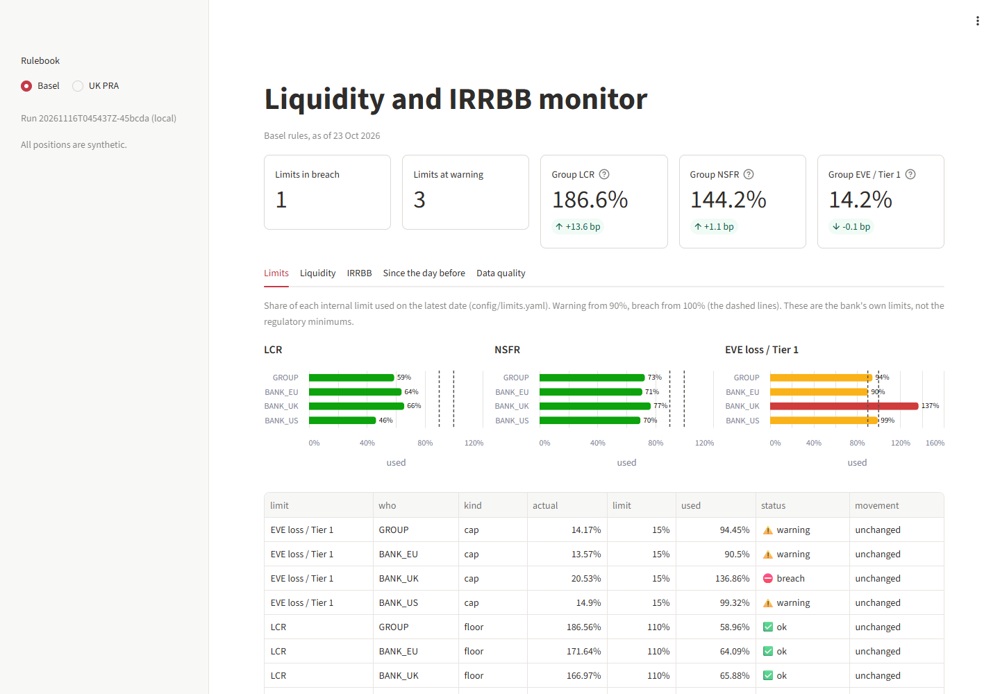

# Liquidity and IRRBB Monitoring Platform

An automated daily pipeline that measures a bank's **liquidity risk** (LCR, NSFR, maturity
ladder) and **interest rate risk in the banking book** (ΔEVE with the outlier test, ΔNII,
repricing gap). It runs under the **Basel III standards and the UK PRA rules side by side**,
checks the results against the bank's internal limits, and reports them through:
- an alert email;
- a dashboard;
- Tableau extracts;
- a daily PDF.

> **All positions are synthetic.** A generator builds a made-up bank (3 entities, 3 currencies,
> 14 product types, pay-fixed swap hedges), optionally on real market curves (FRED, ECB, Bank of
> England). The methods follow the official texts; every simplification is listed in the docs.



## What it does

```
synthetic bank (or real curves) -> raw files + control totals
  -> independent raw checks (DuckDB SQL)
  -> quality layer: quarantine, reconciliation, STOP / WARNING checks   -> data/validated/
  -> liquidity: LCR, NSFR, maturity ladder           (Basel and UK PRA)
  -> IRRBB: six standardised shocks, ΔEVE, outlier test, ΔNII, gap (Basel and UK PRA)
  -> internal limits: utilisation, ok / warning / breach
  -> what changed since the day before (limit movements; balance moves split into volume and FX)
  -> Tableau CSV extracts, daily PDF report
  -> S3 (every run under its id, latest.json last) -> one limit alert email
  -> DuckDB SQL views over the latest good run -> Streamlit dashboard
```

**Every day in AWS** (Terraform):
- EventBridge Scheduler starts a Fargate task from the Docker image;
- the results go to a private S3 bucket, the logs to CloudWatch;
- emails go out through SNS: one when a run fails, one when an internal limit is at warning or
  breach.

**Locally**, the same stages run as Dagster assets, with lineage, checks and a schedule.

## Why a risk reader can trust the numbers

- **Sourced parameters.** Every regulatory factor sits in YAML with its paragraph or Article
  reference, not in code:
  - Basel LCR20-40, NSF20-30 and SRP31;
  - the PRA Rulebook's LCR and NSFR (CRR) Parts and ICAA chapter 9.
- **Checked against published examples.**
  - Hand-worked examples were written before the code.
  - The shock formulas reproduce Basel's own worked example (SRP31.92).
  - Planted formula bugs are caught by the tests.
- **Data quality first.** Metrics only ever read validated data:
  - a bad row is quarantined with its reason;
  - a control-total mismatch stops the run, and nothing is published.
- **One source of numbers.** The alert email, dashboard, extracts and PDF all read the same run
  through the same SQL views, so they cannot disagree.
- **Labelled simplifications.** Each methodology doc ends with its assumptions, for example
  non-maturity deposit behaviour, free transfer of liquidity within the group, and the NII
  horizon.

## Results on the synthetic bank (illustrative)

- **Liquidity:** LCR and NSFR are well above both the minimums and the internal limits.
- **IRRBB:** BANK_UK is an **IRRBB outlier**. Its long fixed-rate mortgages give a worst EVE
  loss of about 20% of Tier 1 under the steepener, so it breaches the EVE limit under both
  rulebooks.
- **Group:** pay-fixed swaps bring the group from 22.0% of Tier 1 (unhedged) to about 14%. That
  is below the 15% test, but close enough to be at warning.

**Model validation** of the LCR's retail deposit run-off rates (5% and 10%), against 54 years of
Federal Reserve H.8 deposit data and a planted deposit run. The pass/fail criteria were written
before any result. The overall rating is **AMBER**: calendar spikes in the all-bank series (a
first RED was traced to a confirmed 1985 break in the Fed's data, and re-rated openly). In
2008, 2020 and 2023, system-wide deposits fell by at most 3.9% in 4 weeks, well within the
rates. But a run the size of Silicon Valley Bank's would take two entities below the LCR
minimum. Details and
recommendations: [validation report](docs/validation_report.md).

[Daily report, page 1](docs/images/daily_report_page1.png)

## Quickstart

Python 3.11 or later (developed on 3.12).

```
python -m venv venv
venv\Scripts\activate                 # Windows (Linux / macOS: source venv/bin/activate)
pip install -e ".[dev,dashboard]"

riskplatform-run                      # whole pipeline, offline: exit 0 clean, 1 stopped, 2 findings
riskplatform-dashboard                # the dashboard on http://localhost:8501
python -m riskplatform.query "SELECT regime, entity, lcr FROM lcr WHERE level = 'entity'"
```

Outputs go under `data/`:

| Folder | What |
|---|---|
| `validated/` | The data the metrics read |
| `metrics/<run>/` | LCR, NSFR, maturity ladder |
| `irrbb/<run>/` | ΔEVE, outlier test, ΔNII, gap |
| `limits/<run>/` | Utilisation and status of each limit |
| `changes/<run>/` | What changed since the day before |
| `extracts/latest/` | Tableau CSVs |
| `reports/<run>/daily_report.pdf` | The daily report |
| `logs/` | One log file per run |

Also:

```
riskplatform-run --as-of today        # every business day up to today (what the AWS task runs)
dagster dev                           # Dagster UI (pip install -e ".[orchestration]")
docker build -t riskplatform .       # then: docker run --rm riskplatform
pytest; ruff check .; ruff format --check .
```

## Documentation

| Document | Covers |
|---|---|
| [Liquidity methodology](docs/liquidity_methodology.md) | LCR, NSFR, ladder; Basel vs PRA; assumptions; verification |
| [Liquidity worked example](docs/liquidity_worked_example.md) | LCR, NSFR and the ladder by hand, before the code |
| [IRRBB methodology](docs/irrbb_methodology.md) | Shocks, ΔEVE, aggregation, outlier test, ΔNII; Basel vs PRA |
| [IRRBB worked example](docs/irrbb_worked_example.md) | ΔEVE and ΔNII by hand; reproduces Basel's SRP31.92 example |
| [Data quality](docs/data_quality.md) | Quarantine, reconciliation, STOP / WARNING checks, breaks report |
| [Data dictionary](docs/data_dictionary.md) | Every input field, allowed values, licences |
| [Limits, alerts and reporting](docs/reporting.md) | Internal limits, email, daily changes, dashboard, extracts, PDF |
| [Model validation report](docs/validation_report.md) | Backtest of the LCR retail run-off rates: criteria set first, Fed H.8 data, stress episode, sensitivity, recommendations |
| [Deploying to AWS](infra/README.md) | Terraform, billing alarm first, schedule, alerts, cost |

## Engineering

- **Stack:**
  - Python with pandas, numpy, pydantic v2 (strict configs) and pandera (data contracts);
  - DuckDB over Parquet;
  - Dagster, Streamlit, ReportLab;
  - boto3, Docker and Terraform (AWS provider 6).
- **Tests:** over 650 pytest tests, including whole-pipeline runs, a fake AWS (moto), the
  dashboard run headless, PDF text read back, and checks that the validation report's numbers
  equal what the code computes.
- **CI (GitHub Actions):** lint, format and tests; builds the Docker image and runs the pipeline
  in it; checks Terraform formatting and validates the code.
- **Security:**
  - no credentials in code or config (an AWS profile locally, IAM roles in AWS);
  - least-privilege IAM with no wildcard actions (tested);
  - a private, encrypted, HTTPS-only bucket;
  - a non-root container.

## Project layout

```
config/                 every parameter and limit (YAML, validated; regulatory references inline)
src/riskplatform/
  ingestion/            synthetic bank generator, real market curves
  validation/ quality/  raw checks; quarantine, reconciliation, breaks report
  metrics/ irrbb/       LCR, NSFR, ladder; shocks, ΔEVE, ΔNII, repricing gap
  limits.py changes.py  internal limits; what changed since the day before
  notify.py             limit alert email (SNS)
  query.py              DuckDB views over the latest good run (local or S3)
  dashboard/ extracts.py report.py   Streamlit, Tableau CSVs, daily PDF
  pipeline.py           the whole run in one command; orchestration/ for Dagster
  storage.py            publishing to S3
  model_validation/     run-off backtest on Fed H.8 data, sensitivity, riskplatform-validate
infra/terraform/        AWS: billing alarm, then the platform
docs/                   methodology, worked examples, data quality, reporting, validation
tests/                  pytest
```
